# Architecture — CyberForge 2026

## Overview
Modular pipeline: ingest FortiGate logs → parse → normalize → Parquet → DuckDB analytics → detection/correlation → MITRE mapping → attack graph → reachability → FastAPI → React/Cytoscape.

## Modules
1. Ingestion (Rust): streaming, chunked, memory-bounded.
2. Parser (Rust): FortiGate key=value, quoted values.
3. Normalization (Rust/Python boundary): typed event schema (Arrow).
4. Storage (Parquet + Zstd): columnar, partitioned by date/type.
5. Analytics (DuckDB): SQL over Parquet, spill to disk.
6. Detection (Python + YAML rules).
7. MITRE mapping (YAML/JSON lookup).
8. Correlation (Python): incident grouping.
9. Attack graph (NetworkX).
10. Reachability (NetworkX algorithms).
11. API (FastAPI).
12. Frontend (React + Cytoscape.js).

## Diagram

```mermaid
flowchart LR
  A[FortiGate logs] --> B[Ingestion]
  B --> C[Parser]
  C --> D[Normalization]
  D --> E[Parquet/Zstd]
  E --> F[DuckDB]
  F --> G[Detection]
  G --> H[MITRE]
  H --> I[Correlation]
  I --> J[Attack Graph]
  J --> K[Reachability]
  K --> L[FastAPI]
  L --> M[React/Cytoscape]
```

